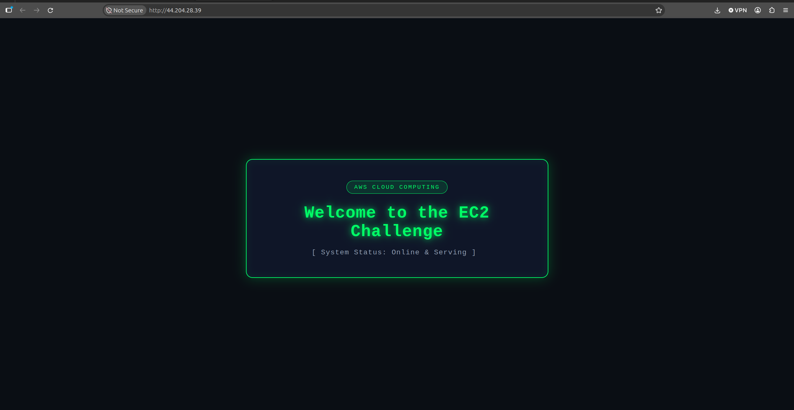

# Student name: YI MONIROM
# Student ID: e20220407
# Learner Lab user name: eee_W_7100257
# Date completed: 24/10/2026


## Part 1.1 — An Amazon EC2 Walkthrough
### Task 1 — Create a Security Group
**Security group**

### Task 2 — Create a Key Pair
**Key pair**

### Task 3 — Launch an Instance
**Instance details**

### Task 4 — Test the Instance
Approach 1 — Browser

**Browser test**

Approach 2 — SSH from your own computer
**SSH connection**

## Part 1.2 — Set Up an EC2 Web Solution (Challenge)
### Launch configuration
### Security group
### Running instance
### Commands on the instance
```shell
# Install nginx
sudo dnf update -y
sudo dnf install -y nginx
sudo systemctl start nginx
sudo systemctl enable nginx
```
```html
// "/usr/share/nginx/html/index.html"
<!DOCTYPE html>
<html lang="en">
<head>
    <meta charset="UTF-8">
    <meta name="viewport" content="width=device-width, initial-scale=1.0">
    <title>EC2 Challenge</title>
    <style>
        * {
            margin: 0;
            padding: 0;
            box-sizing: border-box;
        }
        body {
            background-color: #0a0e14;
            color: #00ff66;
            font-family: 'JetBrains Mono', 'Fira Code', 'Courier New', Courier, monospace;
            display: flex;
            justify-content: center;
            align-items: center;
            min-height: 100vh;
        }
        .card {
            background: rgba(15, 23, 42, 0.9);
            padding: 45px 55px;
            border-radius: 14px;
            border: 1.5px solid #00ff66;
            box-shadow: 0 0 25px rgba(0, 255, 102, 0.25), inset 0 0 15px rgba(0, 255, 102, 0.08);
            text-align: center;
            max-width: 650px;
        }
        .badge {
            display: inline-block;
            font-size: 0.8rem;
            text-transform: uppercase;
            letter-spacing: 2px;
            padding: 6px 16px;
            border-radius: 50px;
            background: rgba(0, 255, 102, 0.12);
            border: 1px solid #00ff66;
            margin-bottom: 22px;
        }
        h1 {
            font-size: 2.2rem;
            font-weight: 700;
            color: #00ff66;
            letter-spacing: 1px;
            text-shadow: 0 0 12px rgba(0, 255, 102, 0.7), 0 0 24px rgba(0, 255, 102, 0.3);
            margin-bottom: 16px;
        }
        p {
            color: #94a3b8;
            font-size: 0.95rem;
            letter-spacing: 1px;
        }
        .cursor {
            display: inline-block;
            width: 8px;
            height: 16px;
            background: #00ff66;
            animation: blink 1s infinite;
            vertical-align: middle;
            margin-left: 5px;
        }
        @keyframes blink {
            0%, 50% { opacity: 1; }
            51%, 100% { opacity: 0; }
        }
    </style>
</head>
<body>
    <div class="card">
        <div class="badge">AWS Cloud Computing</div>
        <h1>Welcome to the EC2 Challenge</h1>
        <p>[ System Status: Online & Serving ]<span class="cursor"></span></p>
    </div>
</body>
</html>

```
### Browser test

### Questions & Answer
1. **Your security group has an SSH rule and an HTTP rule. What does each one let you do? What would stop working if you deleted the HTTP rule?**
   - **SSH Rule (Port 22):** Allows inbound traffic over port 22, enabling administrators to securely connect to the instance's CLI via SSH (using terminal and private key pair) for configuration and management.
   - **HTTP Rule (Port 80):** Allows inbound unencrypted web traffic over port 80, allowing public web browsers to load website content hosted by the web server (Nginx/Apache).
   - **If the HTTP rule is deleted:** Inbound traffic on port 80 will be blocked by the Security Group firewall. Users will no longer be able to access the web page via a browser (the request will time out), although SSH administrative access will still work normally.
2. **In Part 1.1 you never logged in to install the web server. What installed it, and when did it run?**
   - **What installed it:** The **User Data** bootstrap script specified under the **Advanced Details** section during the EC2 launch setup.
   - **When it ran:** It was executed automatically by `cloud-init` with root privileges during the instance's **initial first boot**.
3. **Why does the web page open with `http://` but not with `https://`?**
   - `http://` operates over unencrypted port 80, which is both listening on the web server and permitted by the Security Group inbound rules.
   - `https://` requires an **SSL/TLS certificate** installed and configured on the web server, the web server listening on port 443, and an inbound Security Group rule allowing **HTTPS (Port 443)**. Because none of these are configured yet, HTTPS connections fail or time out.
4. **Part 1.2 asked for a 10 GiB root volume. Where in the launch settings did you set it, and how can you check the size on the running instance?**
   - **Where in launch settings:** In the **Configure Storage** (or **Storage (volumes)**) section of the EC2 launch wizard, by changing the root EBS volume size from the default (usually 8 GiB) to **10 GiB**.
   - **How to check on the running instance:** Connect via SSH and run either of these commands:
     - `lsblk` (lists block devices and their allocated sizes, showing the 10G disk)
     - `df -h /` (shows the mounted root filesystem size and available space)
