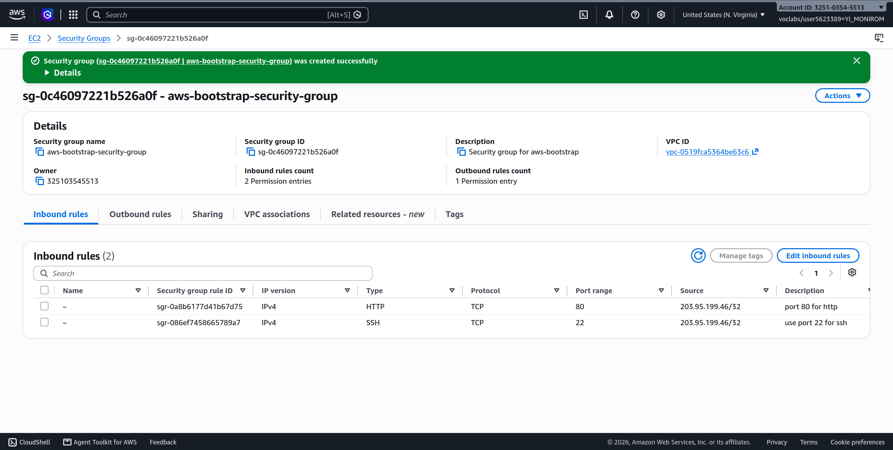
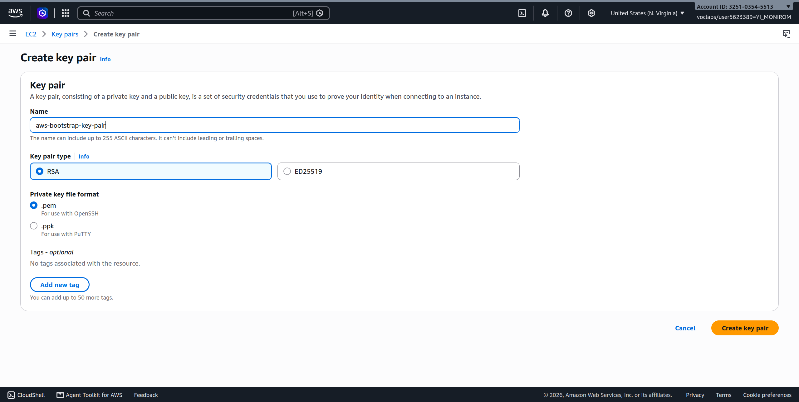
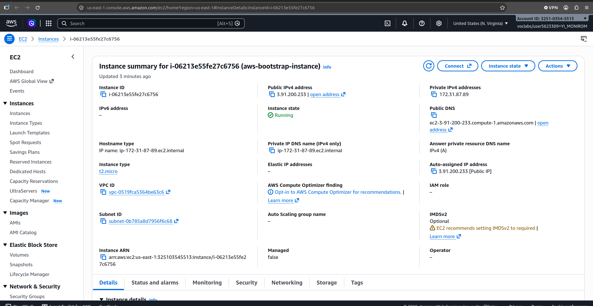
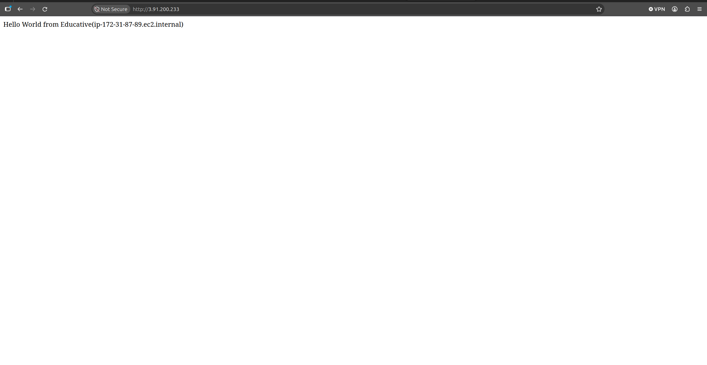
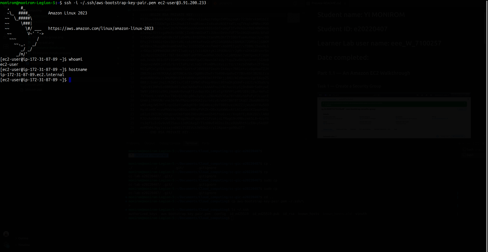
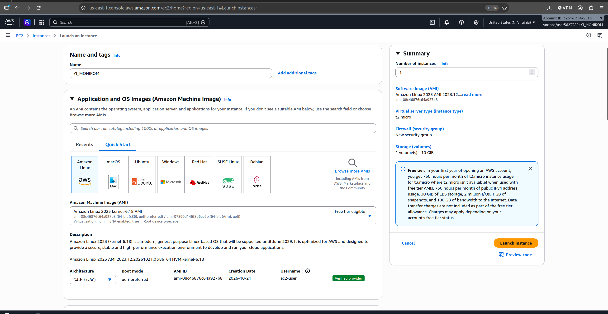
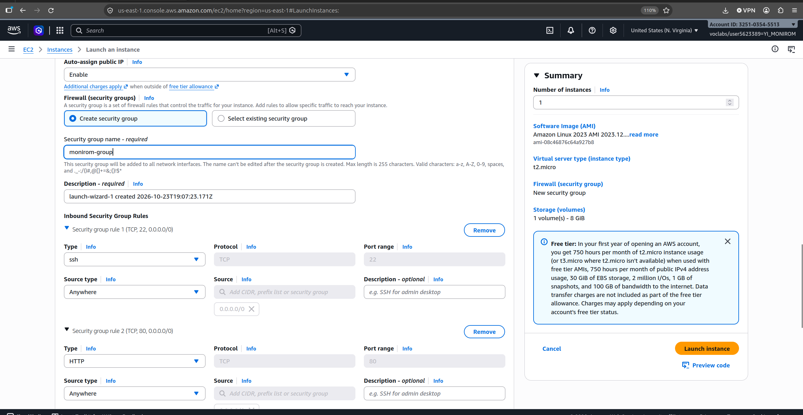
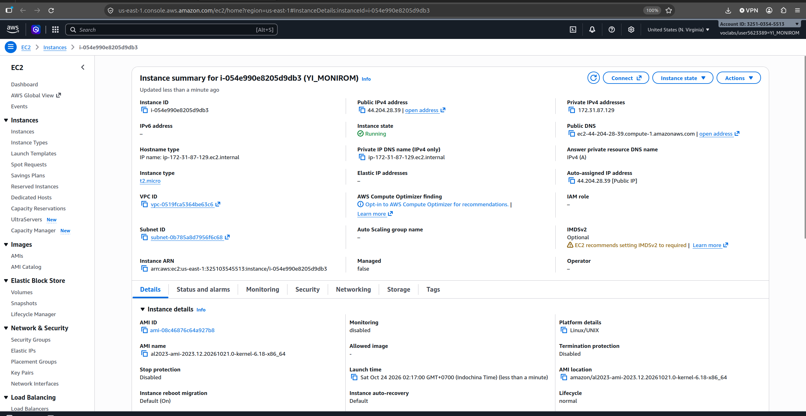
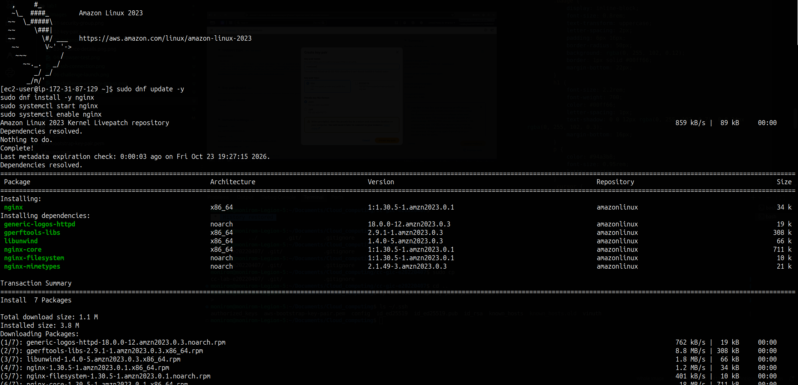

# Cloud Lab 1 Submission — Amazon EC2

Copy this template to `cc-lab-YOUR_ID/lab1/README.md` in your own repository. Follow [the instructions](lab1-instruction.md). Put your screenshots in `lab1/images/` with the file names below.

- **Student name:** YI MONIROM
- **Student ID:** e20220407
- **Learner Lab user name:** YI MONIROM
- **Date completed:** 24/10/2026

---

## Part 1.1 — An Amazon EC2 Walkthrough

### Security group



### Key pair



### Instance details



### Browser test



### SSH connection



Did you connect with your own SSH client or with EC2 Instance Connect?

I connected with my own SSH client from my local terminal (Ubuntu).

---

## Part 1.2 — EC2 Web Solution (Challenge)

### Launch configuration



### Security group



### Running instance



### Commands on the instance



Paste the commands you ran to install the web server and create `index.html`:

```bash
# Update packages and install Nginx
sudo dnf update -y
sudo dnf install -y nginx

# Start and enable Nginx service to start on boot
sudo systemctl start nginx
sudo systemctl enable nginx

# Create styled index.html page
cat << 'EOF' | sudo tee /usr/share/nginx/html/index.html
<!DOCTYPE html>
<html lang="en">
<head>
    <meta charset="UTF-8">
    <meta name="viewport" content="width=device-width, initial-scale=1.0">
    <title>EC2 Challenge</title>
    <style>
        * {
            margin: 0;
            padding: 0;
            box-sizing: border-box;
        }
        body {
            background-color: #0a0e14;
            color: #00ff66;
            font-family: 'JetBrains Mono', 'Fira Code', 'Courier New', Courier, monospace;
            display: flex;
            justify-content: center;
            align-items: center;
            min-height: 100vh;
        }
        .card {
            background: rgba(15, 23, 42, 0.9);
            padding: 45px 55px;
            border-radius: 14px;
            border: 1.5px solid #00ff66;
            box-shadow: 0 0 25px rgba(0, 255, 102, 0.25), inset 0 0 15px rgba(0, 255, 102, 0.08);
            text-align: center;
            max-width: 650px;
        }
        .badge {
            display: inline-block;
            font-size: 0.8rem;
            text-transform: uppercase;
            letter-spacing: 2px;
            padding: 6px 16px;
            border-radius: 50px;
            background: rgba(0, 255, 102, 0.12);
            border: 1px solid #00ff66;
            margin-bottom: 22px;
        }
        h1 {
            font-size: 2.2rem;
            font-weight: 700;
            color: #00ff66;
            letter-spacing: 1px;
            text-shadow: 0 0 12px rgba(0, 255, 102, 0.7), 0 0 24px rgba(0, 255, 102, 0.3);
            margin-bottom: 16px;
        }
        p {
            color: #94a3b8;
            font-size: 0.95rem;
            letter-spacing: 1px;
        }
        .cursor {
            display: inline-block;
            width: 8px;
            height: 16px;
            background: #00ff66;
            animation: blink 1s infinite;
            vertical-align: middle;
            margin-left: 5px;
        }
        @keyframes blink {
            0%, 50% { opacity: 1; }
            51%, 100% { opacity: 0; }
        }
    </style>
</head>
<body>
    <div class="card">
        <div class="badge">AWS Cloud Computing</div>
        <h1>Welcome to the EC2 Challenge</h1>
        <p>[ System Status: Online & Serving ]<span class="cursor"></span></p>
    </div>
</body>
</html>
EOF
```

### Browser test


---

## Questions

1. Your security group has an SSH rule and an HTTP rule. What does each one let you do? What would stop working if you deleted the HTTP rule?
   - **SSH rule (Port 22):** Allows inbound traffic over port 22, enabling administrators to securely connect to the instance's command line via SSH using a private key for remote management.
   - **HTTP rule (Port 80):** Allows inbound unencrypted web traffic over port 80, enabling web browsers across the internet to access web pages served by the web server (Nginx/Apache).
   - **If the HTTP rule is deleted:** Inbound traffic to port 80 will be blocked by the Security Group firewall. Browsers attempting to load the site will time out, though SSH access will remain functional.

2. In Part 1.1 you never logged in to install the web server. What installed it, and when did it run?
   - **What installed it:** The **User Data** bootstrap script entered in the **Advanced Details** section during instance launch.
   - **When it ran:** It was executed automatically with root privileges by `cloud-init` during the instance's initial first boot.

3. Why does the web page open with `http://` but not with `https://`?
   - `http://` runs over unencrypted port 80, which is both listening on Nginx and allowed in the Security Group.
   - `https://` requires an **SSL/TLS certificate** installed and configured on the web server, Nginx listening on port 443, and an inbound Security Group rule allowing **HTTPS (Port 443)**. Because SSL/TLS is not configured and port 443 is closed in the Security Group, HTTPS connections fail.

4. Part 1.2 asked for a 10 GiB root volume. Where in the launch settings did you set it, and how can you check the size on the running instance?
   - **Where in launch settings:** In the **Configure Storage** (or **Storage (volumes)**) section of the EC2 launch wizard by changing the root EBS volume size from 8 GiB to **10 GiB**.
   - **Checking size on running instance:** Run `lsblk` (lists block device storage partitions and sizes) or `df -h /` (displays filesystem disk usage in human-readable form).

## Problems and how I solved them (optional)

- **SSH Private Key Permission Warning:** Encountered `WARNING: UNPROTECTED PRIVATE KEY FILE! Permissions 0664 are too open` when attempting to SSH. Solved by restricting permissions to read-only for owner using `chmod 400 ~/.ssh/aws-bootstrap-key-pair.pem`.
- **Git Security for Key Pairs:** Configured `.gitignore` with `keypair/`, `*.pem`, and `*.ppk` to prevent private key credentials from being tracked or pushed to the remote GitHub repository.

## AI note (optional)

One suggestion an AI tool gave you and how you checked it.

- The AI assistant identified that the SSH permission error was caused by `0664` file permissions on the `.pem` key file and that `ip-172-31-87-89.ec2.internal` was the internal DNS rather than the login user. It suggested running `chmod 400` and connecting with the `ec2-user` username (`ssh -i ~/.ssh/aws-bootstrap-key-pair.pem ec2-user@3.91.200.233`). I checked this by running the command in terminal and successfully established an SSH session.

## Clean up

- [x] Part 1.1: instance terminated, key pair and security group deleted.
- [x] Part 1.2: instance terminated, security group (and key pair, if any) deleted.
