# Cloud Lab 4 Submission — Amazon VPC

Copy this template to `cc-lab-YOUR_ID/lab4/README.md` in your own repository. Follow [the instructions](lab4-instruction.md). Put your screenshots in `lab4/images/` with the file names below.

- **Student name:** YI MONIROM
- **Student ID:** e20220407
- **Learner Lab user name:** YI MONIROM
- **Date completed:** 06/11/2026

---

## VPC and internet gateway

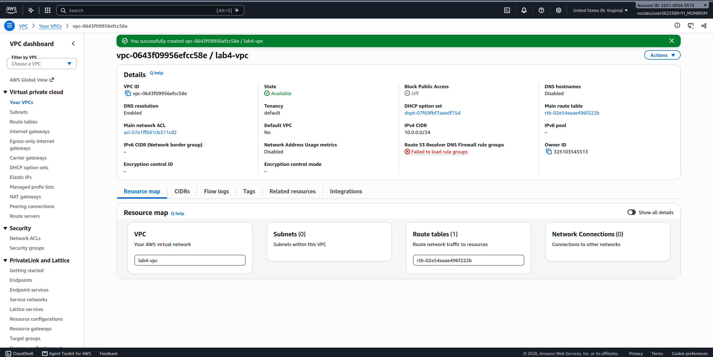

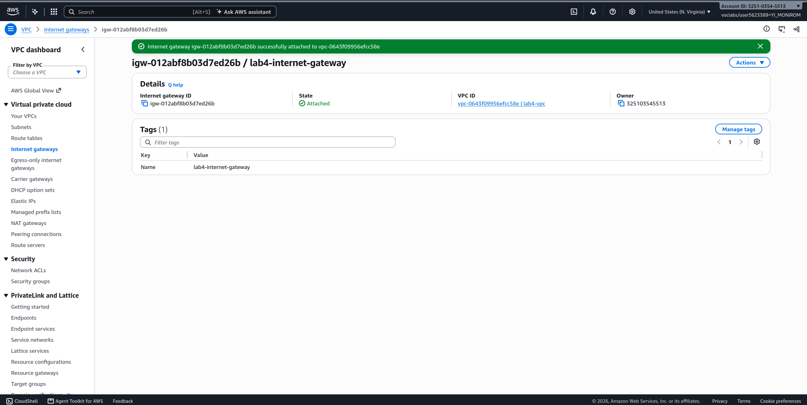

## Public subnet

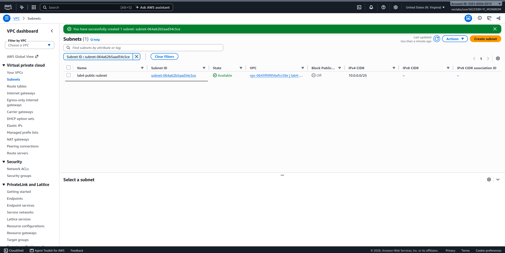

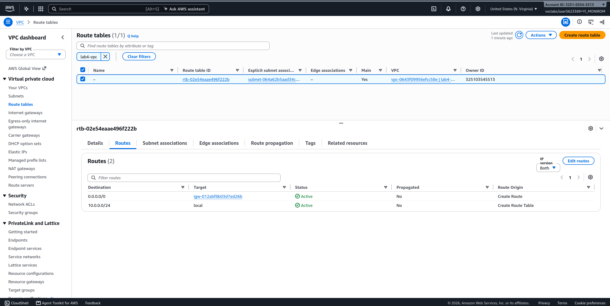

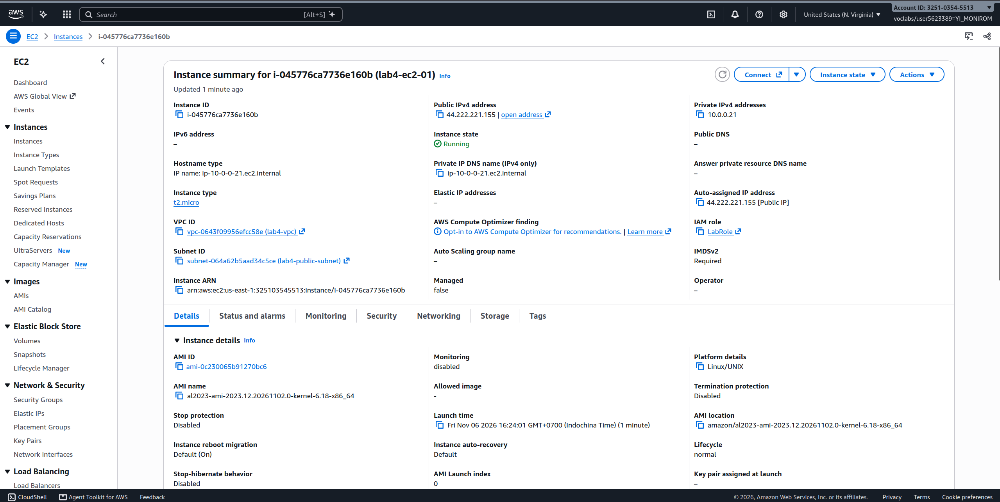

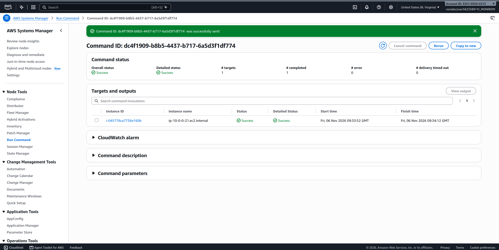

## Private subnet

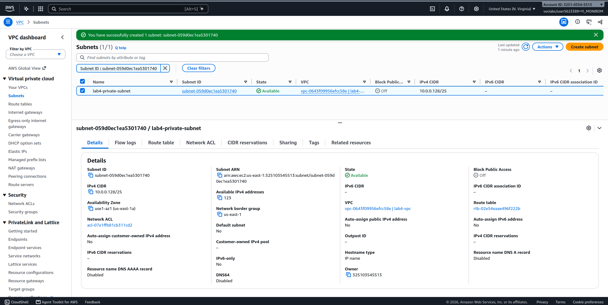

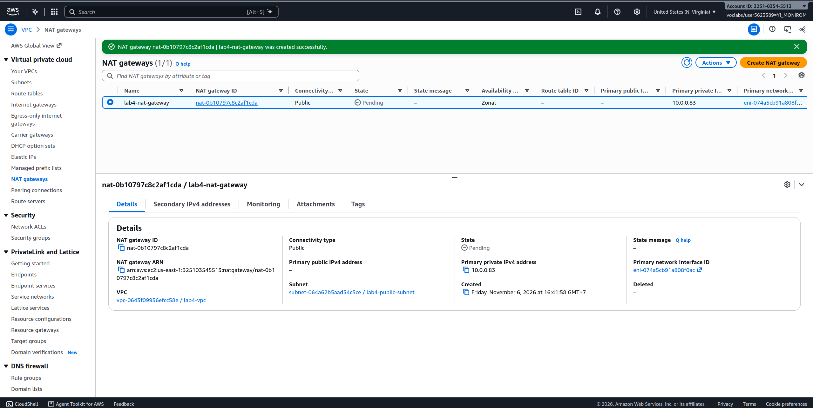

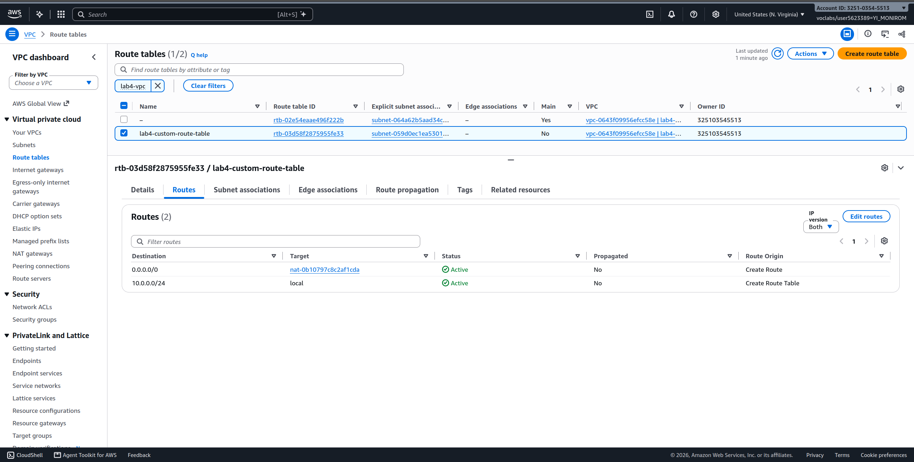

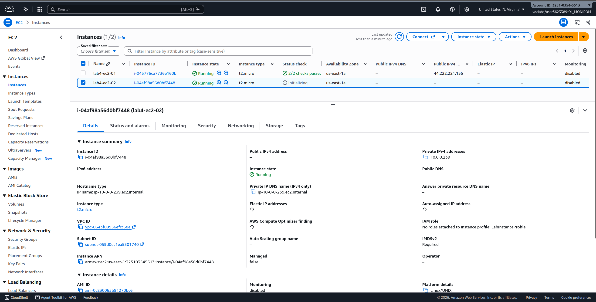

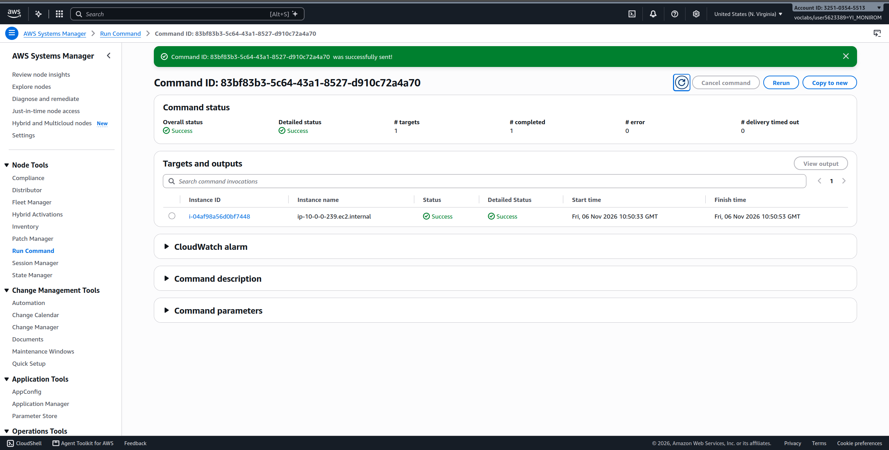

---

## Questions

1. The VPC is `10.0.0.0/24` and the subnets are `10.0.0.0/25` and `10.0.0.128/25`. How many IP addresses does each block contain, and why do the two subnets not overlap?
   - **IP Counts:** The VPC (`/24`) contains **256** total IP addresses ($2^8$). Each `/25` subnet contains **128** total IP addresses ($2^7$), with 123 usable in AWS (since AWS reserves 5 IP addresses per subnet).
   - **Why they do not overlap:** The prefix `/25` uses the 25th bit to divide the `/24` address space into two separate, non-overlapping ranges: `10.0.0.0/25` spans `10.0.0.0`–`10.0.0.127` (25th bit is `0`), while `10.0.0.128/25` spans `10.0.0.128`–`10.0.0.255` (25th bit is `1`).

2. Both subnets are in the same VPC. What exactly makes `lab4-public-subnet` public and `lab4-private-subnet` private?
   - **`lab4-public-subnet`:** Its associated route table has a default route (`0.0.0.0/0`) targeting an **Internet Gateway (IGW)**, enabling direct two-way traffic with the internet.
   - **`lab4-private-subnet`:** Its associated route table does **not** have a route to an Internet Gateway (its `0.0.0.0/0` route points to a NAT Gateway), preventing direct inbound or outbound access from the internet.

3. Why is the NAT gateway placed in the **public** subnet and not in the private one?
   - A NAT Gateway requires a direct route to an **Internet Gateway (IGW)** and an Elastic IP to send and receive traffic to/from the internet. Since private subnets lack a route to an IGW, placing the NAT Gateway in a private subnet would prevent it from communicating with the internet. Situated in the public subnet, it can receive traffic from instances in the private subnet and forward it to the IGW.

4. `lab4-ec2-02` has no public IP address. Can someone on the internet open a connection to it? Can it download updates? Explain both answers.
   - **Can someone on the internet open a connection to it? No.** It has no public IP address and resides in a private subnet without an inbound route from the internet. NAT Gateways do not support unsolicited inbound connections from the outside.
   - **Can it download updates? Yes.** It can initiate outbound connections via the **NAT Gateway** in the public subnet, which translates its private IP into the NAT Gateway's public Elastic IP and routes out to the internet through the IGW. The NAT Gateway tracks the state so return traffic from update repositories can reach the instance.

5. You tested internet access with Systems Manager instead of SSH. Why did the instances need `LabInstanceProfile` for this?
   - AWS Systems Manager requires the instance's SSM Agent to authenticate and communicate with the AWS Systems Manager service API. The `LabInstanceProfile` provides an IAM role (with permissions like `AmazonSSMManagedInstanceCore`) granting the instance the necessary rights to register as a managed node and execute remote commands without needing open SSH ports (port 22) or key pairs.

## Problems and how I solved them (optional)

## AI note (optional)

One suggestion an AI tool gave you and how you checked it.

- The AI tool explained that the distinction between a public and private subnet in AWS is defined strictly by whether the subnet's route table contains a route to an Internet Gateway (`0.0.0.0/0 -> igw-...`). I checked this in the AWS VPC Console by comparing the route table associated with `lab4-public-subnet` against the route table for `lab4-private-subnet` (which routes through `nat-...`).

## Clean up

- [x] Instances terminated.
- [x] NAT gateway deleted and its Elastic IP released.
- [x] Internet gateway detached and deleted.
- [x] `lab4-vpc` deleted.